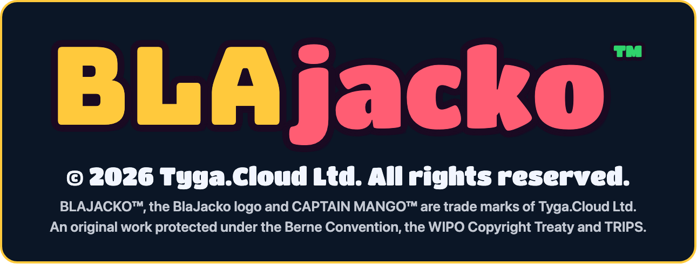

# BLAJACKO™

**© 2026 Tyga.Cloud Ltd. All rights reserved.** BLAJACKO™, the BlaJacko logo and
CAPTAIN MANGO™ are trade marks of Tyga.Cloud Ltd. This repository is the dated public
record of the Work and of the marks in use. It contains no source code and grants no
licence. See [COPYRIGHT](COPYRIGHT).

**The blackjack roguelike. Captain Mango sails the Carnival Isles.**

BlaJacko turns blackjack into a roguelike voyage. You are Captain Mango, a scarlet
macaw pirate, sailing eight carnival islands of blackjack against rival animal
captains, and finally the Kraken. Every winning hand scores by how you won it.

**Play free now: https://blajacko.com**

## The game

- **The Voyage** - eight islands, three blinds each. Hit, stand, double, split and
  surrender to reach each blind's target before your Hands run out.
- **Plunders** - nine ways to win a hand, from a plain Win to a Five-Card Charlie,
  Twenty-One Guns or Hoist the Black Jack, each scored as chips times mult.
- **Your crew** - recruit 24 animal crew members, refit your shoe and follow
  Treasure Maps at the Port Market.
- **Rival captains** - every island's captain has a curse that bends the rules.
- **The Daily Voyage** - one seeded voyage a day, the same for every captain.
- **Clash a friend** - share a code; you both sail the same three islands.
- **The Bounty Board** - a worldwide leaderboard, scored on the server.

## Play

BlaJacko runs in any modern browser on desktop and mobile. No download, no account
needed to start: https://blajacko.com

---

Copyright © 2026 Tyga.Cloud Ltd. All rights reserved. BLAJACKO™, the BlaJacko logo
and CAPTAIN MANGO™ are trade marks of Tyga.Cloud Ltd. BlaJacko, its characters, art,
islands and code are original works protected automatically under the Berne
Convention; no licence, express or implied, is granted by the publication of this
repository or of any release attached to it. See [COPYRIGHT](COPYRIGHT).

A RogueGames Studio Production. Published by Tyga.Games - a division of Tyga.Cloud Ltd.
